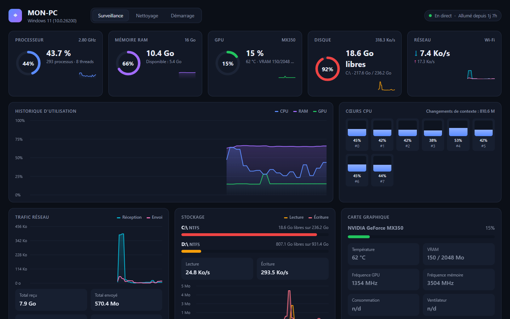
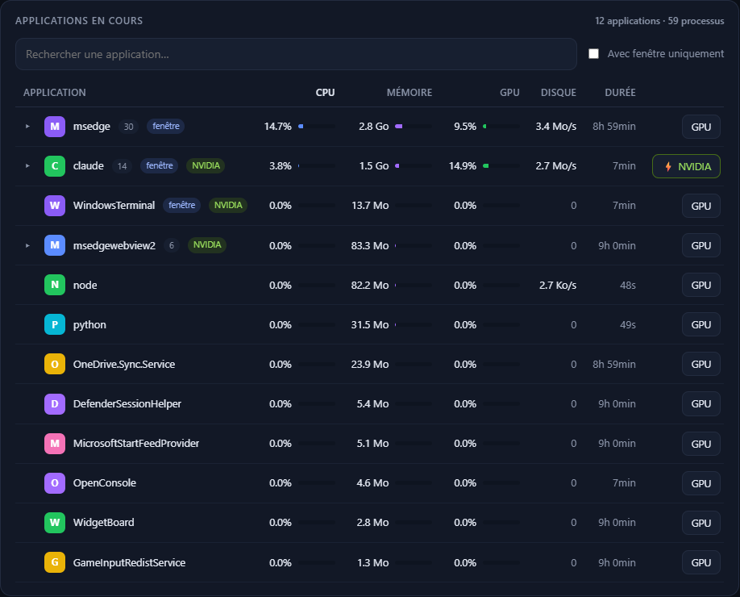
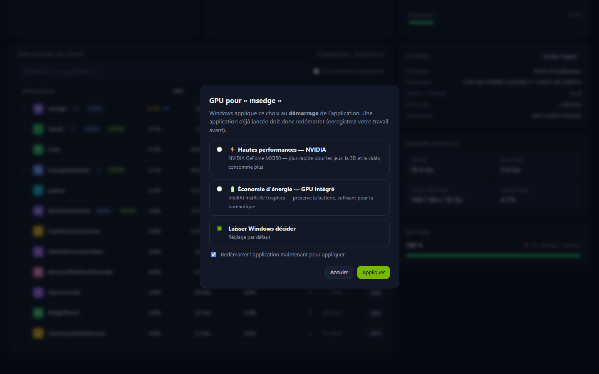
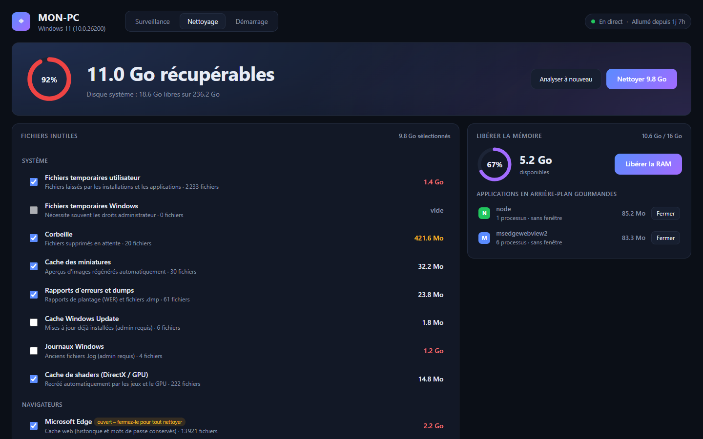
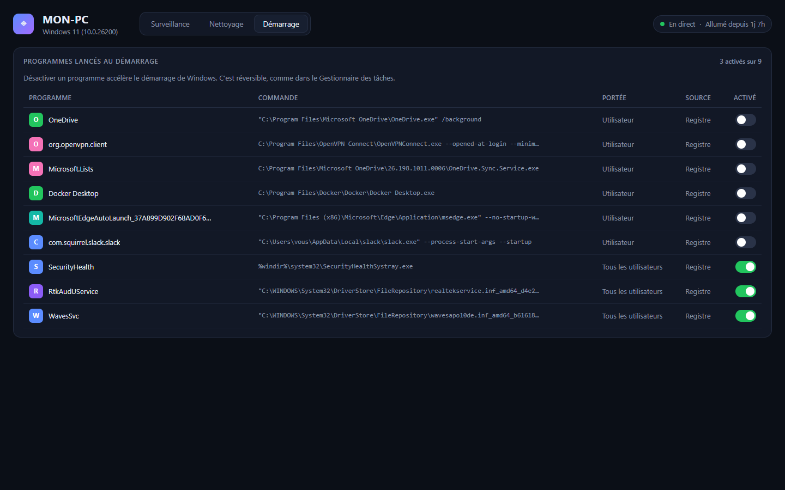

<div align="center">

# PC Monitor: Windows system monitor and PC cleaner

**Real-time CPU, RAM, NVIDIA GPU, disk and network monitoring. Close resource-hungry apps, clean junk files and free up memory from a modern web dashboard.**

A lightweight, free and open-source alternative to Task Manager, CCleaner and CleanMyMac for Windows 10 and Windows 11.


[Version française](README.md)



</div>

> The user interface is currently in French. English translations are welcome.

## Features
- **Live monitoring**:
  - CPU overall and per core, with clock speed;
  - RAM and swap;
  - **NVIDIA GPU** load, temperature, VRAM, clocks and power (via `nvidia-smi`), plus Intel iGPU load;
  - disk space and read/write speed;
  - network speed, totals and active connections;
  - battery, uptime and history charts.
- **App manager**:
  - shows only your applications, without Windows system processes;
  - groups the processes of each program;
  - CPU, memory, GPU and disk usage per app;
  - one-click **close**, with system processes protected.
- **Run any app on the NVIDIA GPU**: choose high performance (NVIDIA), power saving (Intel iGPU) or let Windows decide for each program, and the app restarts automatically. This is the same setting as *Settings › Display › Graphics*.
- **PC cleaner, in the spirit of CleanMyMac**:
  - smart scan for temp files, the recycle bin, thumbnail cache, crash dumps, Windows Update cache and DirectX/NVIDIA shader cache;
  - browser caches for Chrome, Edge, Firefox and Brave;
  - app caches for VS Code, Slack, Teams, Discord and Spotify;
  - developer caches for npm, pip and yarn;
  - **free RAM** button and a **large files finder** that moves files to the recycle bin, so they can be restored.
- **Startup apps**: enable or disable the programs that start with Windows. It is reversible and compatible with Task Manager.

| Apps | NVIDIA GPU | Cleaner | Startup |
|---|---|---|---|
|  |  |  |  |

## Quick start
```bash
git clone https://github.com/YOUR-ACCOUNT/pc-monitor-windows.git
cd pc-monitor-windows
pip install -r requirements.txt
python agent/server.py --local-ui
```
Then open http://127.0.0.1:8765. On Windows you can also double-click `Lancer_PC_Monitor.bat`. Run it as administrator to clean system folders too.

## Host it as a website
You can publish the dashboard on your own domain. Each visitor downloads a small agent (`PCMonitor-Agent.exe`, about 9 MB, no install) and sees **their own PC** in the browser. Their data never leaves their machine. See [DEPLOIEMENT.md](DEPLOIEMENT.md) for the VPS, domain and automatic HTTPS setup with Caddy and Docker.

## Security and privacy
- The agent listens on `127.0.0.1` only. There is no telemetry and no account.
- In website mode, the agent:
  - checks the CORS origin against an allow-list;
  - blocks DNS rebinding by checking the `Host` header;
  - requires a custom header for every action.
- System processes cannot be killed. Large files go to the recycle bin, and every deletion asks for confirmation first.

## License
[MIT](LICENSE)

<sub>Keywords: Windows system monitor, Task Manager alternative, CPU RAM GPU monitor, free PC cleaner, CCleaner alternative, CleanMyMac for Windows, free RAM Windows 11, disk cleanup, force app to use NVIDIA GPU, NVIDIA Optimus, startup programs manager, open-source system dashboard, psutil, nvidia-smi.</sub>
