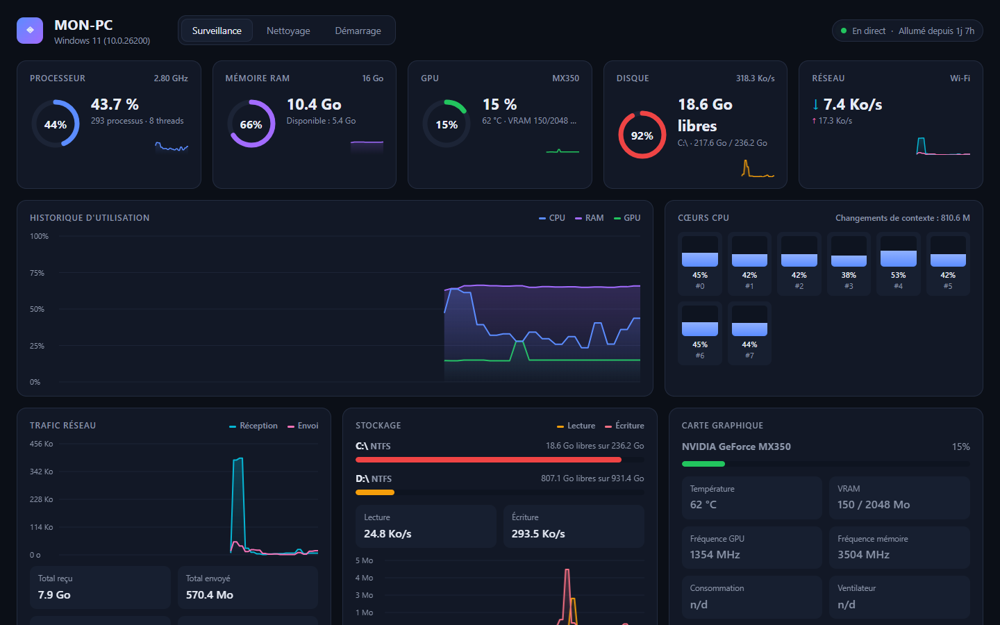
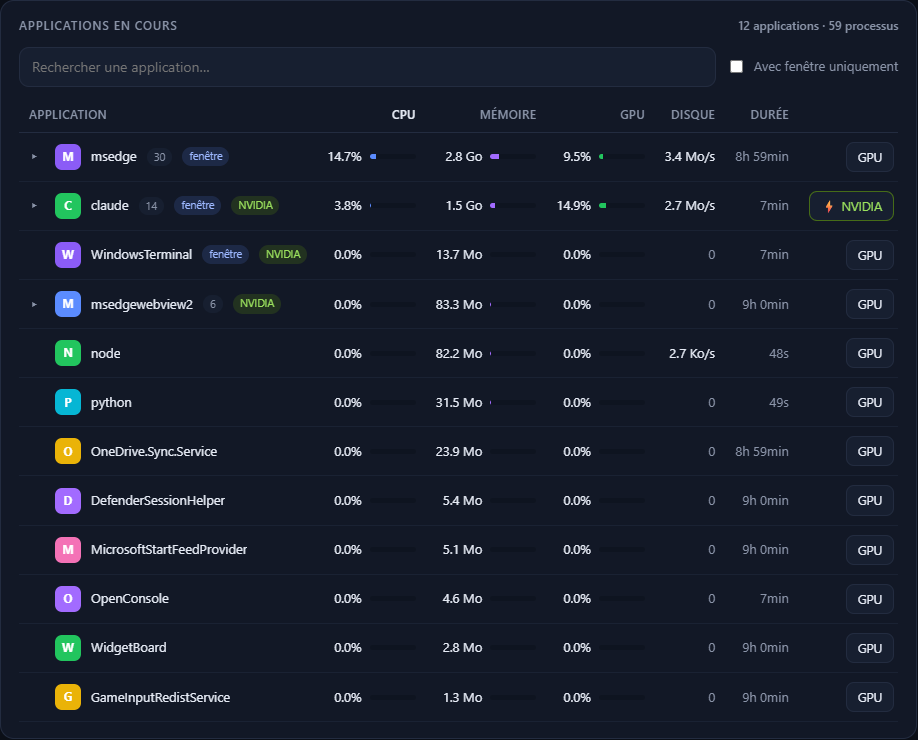
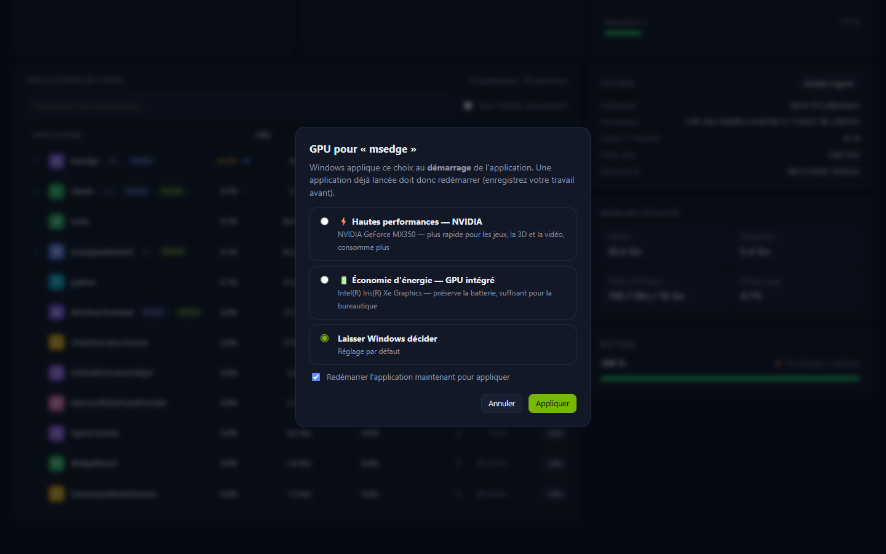
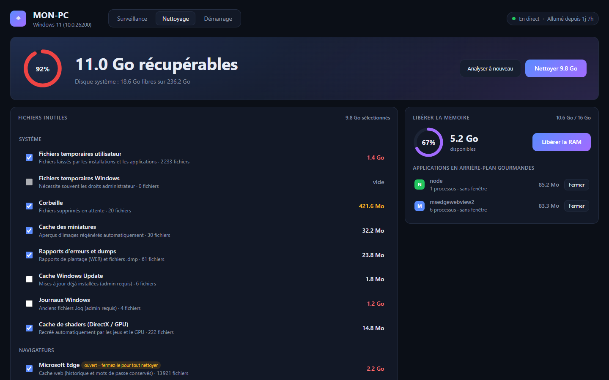
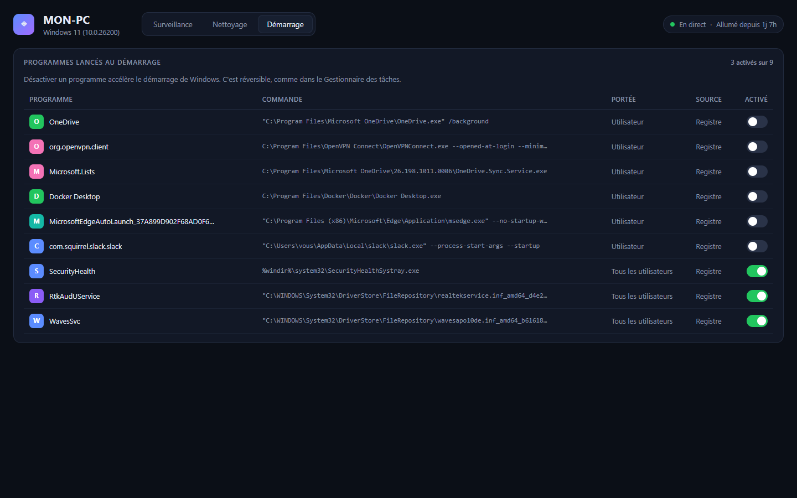
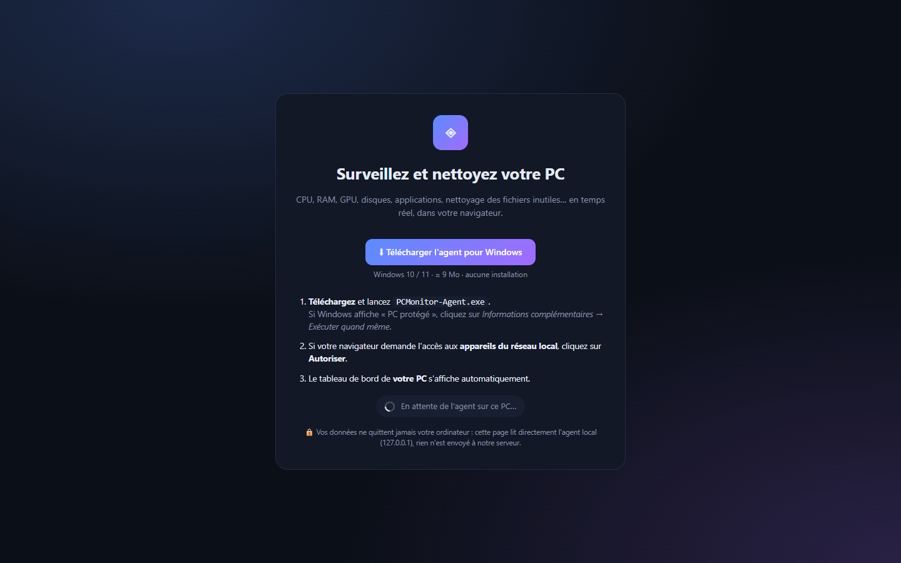

<div align="center">

# PC Monitor : moniteur système et nettoyeur de PC pour Windows

**Surveillez le CPU, la RAM, le GPU NVIDIA, les disques et le réseau en temps réel. Fermez les applications gourmandes, nettoyez les fichiers inutiles et libérez la mémoire, depuis un tableau de bord web moderne.**

Une alternative légère, gratuite et open source au Gestionnaire des tâches, à CCleaner et à CleanMyMac, pour Windows 10 et Windows 11.


[English version](README.en.md) · [Installation](#installation) · [Fonctionnalités](#fonctionnalités) · [Mise en ligne](DEPLOIEMENT.md)



</div>

## Pourquoi PC Monitor ?
Votre PC ralentit ? Le ventilateur s'emballe ? Le disque C: est plein ? **PC Monitor** répond en un coup d'œil :
- **Quoi** consomme le processeur, la mémoire ou la carte graphique.
- **Combien** de gigaoctets vous pouvez récupérer, et en un clic.
- **Quelles** applications démarrent avec Windows et le ralentissent.

Le tout dans une interface sombre et moderne, mise à jour toutes les 1,5 seconde. Aucune donnée ne quitte votre ordinateur.

## Fonctionnalités

### 📊 Surveillance en temps réel
- **Processeur (CPU)** : utilisation globale, utilisation de **chaque cœur**, fréquence, changements de contexte.
- **Mémoire (RAM)** : utilisée et disponible, fichier d'échange (swap).
- **Carte graphique (GPU)** :
  - pour les cartes **NVIDIA** (via `nvidia-smi`) : charge, température, mémoire vidéo (VRAM), fréquences, consommation, ventilateur ;
  - pour les GPU Intel intégrés : charge par adaptateur, via les compteurs Windows.
- **Disques** : espace libre de chaque lecteur, vitesse de lecture et d'écriture.
- **Réseau** : débit en réception et en envoi, total transféré, connexions actives, adresse IP.
- **Batterie** et durée depuis le démarrage, avec un historique sous forme de graphiques.

### 🧩 Gestionnaire d'applications


- Affiche **uniquement vos applications** et masque les processus système de Windows.
- Regroupe les processus de chaque programme : par exemple, les 30 processus de Microsoft Edge forment une seule ligne, que l'on peut déplier.
- Consommation de **CPU, mémoire, GPU et disque par application**.
- Bouton **Fermer** sur chaque application, avec confirmation. Les processus système sont protégés.
- Badge **NVIDIA** sur les applications qui utilisent la carte graphique dédiée.

### ⚡ Lancer une application sur le GPU NVIDIA


Sur les PC portables équipés de deux cartes graphiques (NVIDIA Optimus), choisissez pour chaque programme :
- **Hautes performances** : la carte NVIDIA, pour les jeux, la 3D et le montage vidéo ;
- **Économie d'énergie** : le GPU Intel intégré, pour préserver la batterie ;
- **Laisser Windows décider**.

L'application est **redémarrée automatiquement** sur le GPU choisi. C'est le même réglage que *Paramètres › Affichage › Graphiques*, en un clic.

### 🧹 Nettoyage du PC, dans l'esprit de CleanMyMac


- **Analyse intelligente** des fichiers inutiles, avec la taille de chaque catégorie :
  - Système : fichiers temporaires, corbeille, cache des miniatures, rapports d'erreurs (WER) et dumps, cache Windows Update, journaux, cache de shaders DirectX et NVIDIA ;
  - Navigateurs : cache de Chrome, Edge, Firefox et Brave. L'historique et les mots de passe sont conservés ;
  - Applications : cache de VS Code, Slack, Teams, Discord et Spotify ;
  - Développeurs : cache de pip, npm et yarn.
- **Libérer la RAM** : réduit la mémoire réservée par tous les processus, et liste les applications gourmandes qui tournent en arrière-plan.
- **Gros fichiers** : trouve les fichiers les plus volumineux de votre dossier utilisateur et les envoie **à la corbeille**, donc vous pouvez les restaurer.
- Les fichiers en cours d'utilisation et les fichiers temporaires récents sont ignorés automatiquement.

### 🚀 Programmes au démarrage


Activez ou désactivez les programmes lancés au démarrage de Windows pour **démarrer plus vite**. C'est réversible et compatible avec le Gestionnaire des tâches.

## Installation

### Option 1 : en local (le plus simple)
```bash
git clone https://github.com/abderrahmannjeh/pc-monitor-windows.git
cd pc-monitor-windows
```
Double-cliquez ensuite sur **`Lancer_PC_Monitor.bat`**. Il installe `psutil` puis ouvre le tableau de bord sur http://127.0.0.1:8765.

Pour le lancer à la main :
```bash
pip install -r requirements.txt
python agent/server.py --local-ui
```

> 💡 Pour nettoyer aussi les fichiers système (Windows Update, journaux), lancez le programme **en tant qu'administrateur**.

### Option 2 : comme site web, avec un agent à télécharger
Publiez le tableau de bord sur votre propre domaine. Chaque visiteur télécharge un petit agent (`PCMonitor-Agent.exe`, environ 9 Mo, sans installation) et voit **son propre PC** dans le navigateur.



Le guide complet (VPS, nom de domaine, HTTPS automatique avec Caddy et Docker) est dans **[DEPLOIEMENT.md](DEPLOIEMENT.md)**. En résumé :
```bash
.\deploy.ps1 -Domain monitor.votredomaine.com -Server IP_DU_VPS
```

## Sécurité et vie privée
- 🔒 **Tout reste local** : l'agent écoute uniquement sur `127.0.0.1`, aucune télémétrie, aucun compte.
- 🛡️ En mode site web, l'agent n'accepte que **votre domaine** (vérification CORS de l'origine), bloque les attaques par **DNS rebinding** (vérification de l'en-tête `Host`) et exige un en-tête personnalisé pour toute action.
- ✋ Les processus système et ceux des autres utilisateurs ne peuvent pas être fermés.
- ♻️ Les gros fichiers vont à la corbeille. Seuls les caches régénérables sont supprimés définitivement, et toujours après confirmation.

## Structure du projet
```
agent/
  server.py        collecte des métriques (psutil, nvidia-smi, compteurs Windows) et API HTTP locale
  cleaner.py       nettoyage, libération de la RAM, gros fichiers, programmes au démarrage
  gpu_pref.py      choix du GPU NVIDIA ou Intel par application
  dashboard.html   interface web (HTML, CSS et JavaScript, sans dépendance)
deploy/            Caddyfile, docker-compose.yml, install.sh (VPS Ubuntu)
build_agent.bat    compile l'agent en .exe avec PyInstaller
deploy.ps1         compile, envoie et installe sur le VPS en une commande
```

## Questions fréquentes
**Comment voir ce qui ralentit mon PC Windows ?**
Ouvrez l'onglet *Surveillance* : la liste des applications est triée par consommation de CPU. Triez par mémoire, GPU ou disque d'un clic sur l'en-tête de la colonne.

**Comment libérer de l'espace disque sur Windows 11 ?**
Dans l'onglet *Nettoyage*, cliquez sur *Analyser*, puis sur *Nettoyer*. Sur un PC de développeur, les caches npm et pip et les caches des navigateurs représentent souvent plusieurs gigaoctets.

**Comment forcer un jeu ou un logiciel à utiliser la carte NVIDIA ?**
Cliquez sur le bouton *GPU* de l'application, choisissez *Hautes performances — NVIDIA*, puis *Appliquer*. L'application redémarre sur la carte dédiée.

**Est-ce que ça marche sur Mac ou Linux ?**
La surveillance repose sur `psutil`, qui est multiplateforme. En revanche, le nettoyage, le choix du GPU et les programmes au démarrage sont propres à Windows.

## Contribuer
Les issues et les pull requests sont les bienvenues : nouvelles catégories de nettoyage, prise en charge des GPU AMD, traductions…

## Licence
[MIT](LICENSE) : libre d'utilisation, de modification et de redistribution.

---
<sub>Mots-clés : moniteur système Windows, gestionnaire des tâches alternatif, surveillance CPU RAM GPU, nettoyeur PC gratuit, alternative CCleaner, CleanMyMac pour Windows, libérer RAM Windows 11, nettoyer disque C plein, forcer GPU NVIDIA, NVIDIA Optimus, programmes au démarrage, tableau de bord système open source, psutil, nvidia-smi.</sub>
